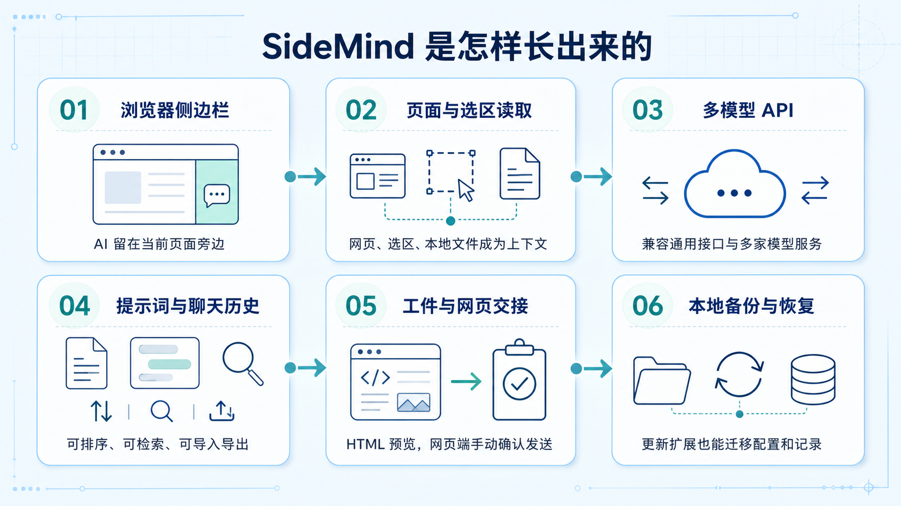
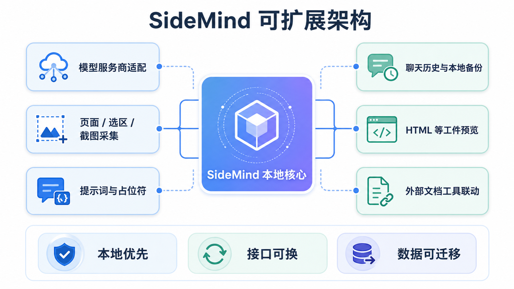

# SideMind 产品说明

> 当前代码候选：`v0.5.31`（2026-09-21，日常工作流优化）；已有本地 Git Tag：`v0.5.30`。本轮未发布新 Tag 或 GitHub Release；远程 Release 状态未重新查询。
> 发布形态：个人使用的 Chrome / Edge Manifest V3 扩展，GitHub Release 提供 ZIP 安装包
> 当前阶段：M4 个人验收运行；不等同于 Chrome 商店、团队或生产服务发布

## 1. 产品判断

Sider 的核心价值不是“把聊天框放到侧边”，而是把浏览器正在发生的事情变成 AI 可用的上下文，并让 AI 的结果回到浏览器工作流。SideMind 因此定位为一个**本地优先、可自带模型、可保存工作过程的浏览器 AI 工作台**。

核心闭环已经从首版的单轮问答扩展为：

```text
网页 / 选区 / 本地文件 / PDF / 截图 / 图片附件
  → 自带模型 API 或 ChatGPT 网页交接
  → 回答 / 工件 / 多模型比较 / 连续追问
  → 本地历史 / JSON 备份 / Markdown 或 PNG 分享
```

SideMind 不提供自有模型服务，也不代管用户 API Key；模型请求直接发送到用户配置的服务商或本地 Ollama。ChatGPT 网页交接仅把提示词写入正常网页输入框，由用户确认发送，不读取 Cookie、不调用私有接口。

## 2. 当前用户任务

1. **阅读与研究**：总结网页、选区、本地 Markdown/TXT/HTML 或可提取文字的 PDF；解释概念、提取重点、持续追问，并在 PDF 问答中保留页码依据。
2. **写作与网页协作**：对选区改写、翻译或生成内容，并在支持的网页输入框中由用户主动写回。
3. **图片与视觉理解**：附加图片、粘贴截图或截取当前可见页面，交给支持视觉能力的模型分析。
4. **多模型验证**：针对同一问题获取其他已配置模型的答案，在原位切换或宽屏并排比较。
5. **本地工作留存**：将会话、图片预览、提示词、工件与偏好留在浏览器本地；通过 Markdown / JSON 导入导出恢复。
6. **本地交付与分享**：按完整问答轮次选择内容，先预览再导出 Markdown 或排版 PNG；可交接到微博、X、微信等已登录平台，但由用户完成发布。

## 3. 当前能力与产品边界

### 已实现能力

- **浏览器上下文**：读取网页正文、选区、支持的 `file://` 文本文件、当前标签页截图、上传附件与剪贴板图片；已增加本地或公共 URL 的文字 PDF 解析、页码范围和可复核引用，原始 PDF 二进制不写入历史或备份。
- **模型与连接**：支持 OpenAI Responses、DeepSeek、OpenRouter、自定义 OpenAI 兼容接口、Ollama 和 ChatGPT 网页交接；设置采用“服务商 → 模型”结构，同一服务商共享连接配置。
- **模型成本可见性**：DeepSeek 在模型切换弹窗的分组标题显示官方可用余额和赠金余额，点击可刷新；其他服务商保留本地 Token 用量与可选预算，不将本地估算伪装为账户余额。
- **会话与恢复**：聊天空间、历史搜索、标题修改、收藏、删除、启动时恢复上次会话或新建会话、Markdown 导入导出，以及完整 JSON 备份恢复。
- **输出复用**：回答可复制、保存 Markdown、引用追问、重新生成、朗读、写入网页、分享和确认删除；代码或 HTML 等结果可生成本地工件，在隔离查看器中预览、编辑、复制和下载。
- **提示词系统**：内置模板库与自定义提示词，支持分类、搜索、显示/隐藏、排序和变量；`${lang}` 读取响应语言，`${input}` 读取网页选区或输入内容。
- **多模型比较**：替代答案继承原问题、上下文、响应语言、思考等级及可用图片；支持 `1 / N` 切换和独立比较页。
- **可用性与恢复**：四档字体大小、悬停说明、请求强制中止、Ollama 403 来源提示、截图权限提示、附件与历史体积预算。
- **本地自愿支持**：捐赠二维码随扩展本地打包，微信支付与支付宝切换不上传支付信息，也不影响功能权限。

### 明确不做或尚未完成

- 不读取 ChatGPT Cookie、不调用 ChatGPT 私有接口、不自动发送网页消息，也不拦截网页响应。
- 不提供跨站自动执行 Agent；密码、支付、删除、发布等高风险操作仍必须由用户确认和完成。
- 扫描型 PDF 不内置 OCR；需由用户选定页面并交给已标记支持视觉输入的模型。DRM、需登录 PDF、YouTube 字幕和复杂阅读器正文仍无专用适配。
- v0.5.31 增加流式回答、停止保留和手动普通模式重试；已完成模拟协议与 Chrome 界面检查，真实服务兼容性仍需复验。
- 当前 M4 仅代表 coolstone 的个人验收运行，不能外推为团队、Chrome 商店或生产服务可靠性结论。

## 4. 版本演进



| 版本 | 日期 | 产品变化 | 用户价值 |
| --- | --- | --- | --- |
| `v0.5.4` | 2026-07-19 | 建立 MV3 侧边栏扩展、网页/选区/截图上下文、模型设置、提示词、基础工件与回归测试。 | 形成“在浏览器侧边栏读取上下文并问 AI”的可用最小闭环。 |
| `v0.5.15` | 2026-07-19 | 恢复内置 OpenAI / DeepSeek 配置；加入聊天 Markdown 导入、标题编辑、空间导出、完整 JSON 备份恢复、图片粘贴、`file://` 读取和截图权限修复。 | 让本地历史、配置和资料在升级或换会话后可恢复，减少数据丢失焦虑。 |
| `v0.5.16` | 2026-07-19 | 加入本地捐赠入口及微信支付 / 支付宝二维码弹窗。 | 为个人维护提供自愿支持入口，且不引入账号、支付或数据采集。 |
| `v0.5.17` | 2026-07-20 | 提供四档字号；模型设置改为“服务商优先”；同一服务商管理多个模型并分组切换。 | 改善侧边栏可读性，降低多模型配置与切换成本。 |
| `v0.5.18` | 2026-07-20 | API 请求支持真实中止；接入 Ollama 本地模型和 403 来源配置指引。 | 用户可取消长请求，也可把本地模型接入浏览器工作流。 |
| `v0.5.20` | 2026-07-21 | 图片作为聊天消息本地保存；支持从其他模型获取答案、原位切换和宽屏并排比较。 | 同一问题可保留图片上下文，并用多模型交叉验证答案。 |
| `v0.5.28` | 2026-07-22 | 分享支持一次选择多轮完整问答；选择问题或任一答案自动联动整轮；PNG/Markdown 预览与导出升级；新增一键发布脚本。 | 对话交付更完整，分享前可预览，发布流程可重复执行。 |
| `v0.5.29` | 2026-07-27 | 根据用户反馈，将 DeepSeek 官方余额放到模型切换器的 DeepSeek 分组标题；其他服务商加入本地 Token 用量与可选预算。 | 余额信息出现在切换模型的决策位置，同时保持“官方余额”和“本地估算”的清晰边界。 |
| `v0.5.30`（已有 Tag） | 2026-08-07 | 增加本地与公共 URL PDF 的文字阅读、文档地图、页码范围提问、`[p. N]` 引用和受控备份；扫描件仅向视觉模型提供用户选定页图像。 | 把长文阅读从“把整本文件塞给模型”改为“先概览、后按页追问、可回查证据”的可复核闭环。 |

| `v0.5.31`（本地候选） | 2026-09-21 | 完整文字历史、独立输入预算、原轮材料快照、全页 PDF 文档地图、流式回答、收藏片段及备份 v2。 | 减少记录丢失、材料错用、等待不透明和成果难找的问题；真实服务、升级与回滚验收待完成。 |

## 5. 来自产品起点的规划校准

作者文章《从 999 元到 1699 元，我决定自己做一个 Sider》（2026-08-04 本地归档于 `url-to-markdown/sideMind-from-999-to-1699/`）明确了 SideMind 的起点：价格只是触发因素，真正要避免的是工作流、模型和历史随服务商套餐一起漂移。因此以下原则优先于“功能数量”或“做得像 Sider”。

1. **控制权必须可见**：模型供应商、模型能力、官方余额与本地预算、实际发送的上下文都应能在操作当下说明白；不把估算伪装成账户事实。
2. **资产必须可恢复**：提示词、历史、工件和配置都需要可导出、可导入、可验证恢复；原始大文件只保留引用与受控片段，避免备份失控。
3. **回答必须可复核**：网页、PDF、图片等阅读能力优先建设来源、页码/片段、失败状态和重新读取路径，而非静默截断或假装已读完。
4. **扩展必须可替换**：上下文采集、服务商适配、提示词、工件渲染、外部文档工具之间保持小接口，新增一种模型或文档类型不应重写聊天主流程。
5. **迭代必须由真实障碍驱动**：一个版本只完成一个能被个人工作流验证的闭环，先补验收、升级恢复和回滚证据，再扩展下一条路径。



## 6. 后续取舍

当前优先级不是继续堆功能，而是维护 M4 个人使用闭环：每次涉及存储、附件、模型请求或分享的改动，都完成升级、JSON 恢复和旧版本回滚复验，并更新版本说明。v0.5.31 已实施日常工作流优化，先完成真实模型和同目录升级复验，再确定新 Tag 与 Release。

若核心路径出现明确的真实使用痛点，再一次只选择一个方向：

1. **证据回链统一化**：将网页段落、PDF 页码、截图和附件引用收敛为同一来源卡与复核入口；这是“可复核阅读”的下一步，不另起一套阅读器。
2. **流式输出验证**：已实现增量 Markdown、停止保留和失败重试，下一步验证各实际服务商的兼容性与长回答滚动体验。
3. **模型能力与成本治理**：把文本/视觉、上下文限制、官方余额/本地预算、Ollama 可达性统一成模型能力卡；只展示可验证的数据。

提示词包、工件渲染器和本地文档工具联动可作为这些核心路径稳定后的扩展层；它们应以可导入、可导出和低耦合的方式实现，而不成为新的平台锁定。

跨站 Agent、自动发布、密码/支付/删除相关自动化，以及面向团队或 Chrome 商店的服务化，必须在权限治理、回滚、隐私和独立验收具备后另行立项。


## 7. 当前迭代与后续优先级

当前负责人：coolstone。v0.5.31 将“记录不丢、上下文准确、回答及时、成果好找”作为同一日常闭环：

- 文字历史完整保存，历史列表分页；失败提示备份或清理，不按数量自动删除。
- 输入预算独立于输出 Token；提供超限阻止与草稿保留，预算明确标为字符估算。
- 原轮保存受控请求与材料元数据，重新生成及比较共用；PDF 地图均分预算覆盖所有页。
- 两类 API 流式输出、停止保留、明确的错误状态、手动普通模式重试，以及本地耗时记录。
- 收藏整条回答或选区，按空间搜索、跳转与 Markdown 导出；随 JSON v2 备份恢复。

常用任务预设和多资料对照阅读仍是后续候选，尚未实现。本轮不新增账号、云同步、向量数据库或跨站自动执行。旧版本已经删掉且无备份的记录无法恢复。自动化结果与人工待验收项以 `tests/v0.5.31-validation.md` 为准。
